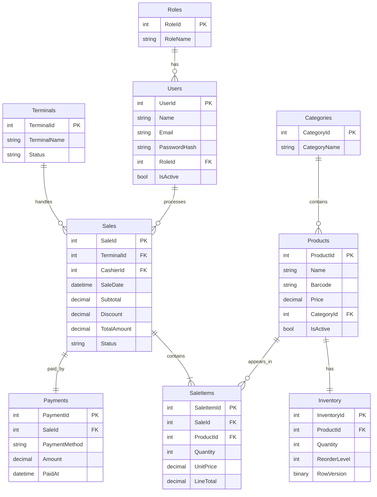

# POSMT Database Design

## ER Diagram

## Tables

| Table | Notes |
|---|---|
| Roles | Manager, Cashier. Seeded at startup. |
| Users | Email is unique. Stores password hash only. CashierId in Sales points here. |
| Terminals | Status is Active or Inactive. TerminalName is unique. |
| Categories | CategoryName is unique. |
| Products | Barcode is unique. Price is never negative. IsActive replaces deletion. |
| Inventory | One row per product. RowVersion is used for concurrency control. |
| Sales | One row per bill. Status is Completed or Cancelled. |
| SaleItems | UnitPrice is copied from Products at sale time. |
| Payments | One payment per sale in the MVP. PaymentMethod is Cash or Card. |

## Key Constraints

- Users.Email: unique
- Products.Barcode: unique
- Terminals.TerminalName: unique
- Inventory.ProductId: unique (one-to-one with Products)
- Inventory.Quantity: must be 0 or more
- Products.Price: must be 0 or more
- SaleItems.Quantity: must be greater than 0
- Payments.SaleId: unique (one payment per sale)

## Delete Rules

- Category with products: delete is blocked.
- Product with sales: deactivate only.
- Sale: never deleted, only Cancelled.

## Concurrency Strategy

Inventory has a RowVersion column. When two terminals try to update the same stock at the same time, Entity Framework Core detects the conflict. The second sale is rejected or retried, so stock never goes below zero.